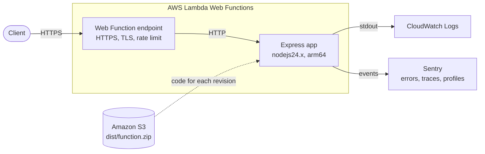

# A lightweight read-only BMI Calculator API using Node.js

## Scenario

Body Mass Index is a simple calculation using a person's height and weight. The formula is BMI = kg/m2 where kg is a person's weight in kilograms and m2 is their height in meters squared. A BMI of 25.0 or more is overweight, while the healthy range is 18.5 to 24.9.

The service is expected to handle a burst of concurrent traffic and should be deployable consistently across isolated environments on a major cloud provider.

## Project goals

- Expose a versioned REST route.
- Provision the network, compute, and supporting resources with reusable Terraform modules.
- Separate environment-specific configuration from shared infrastructure definitions.
- Automate infrastructure planning, image build, and deployment through a CI pipeline.
- Describe how the design can scale and remain observable under load.

## Repository layout

```
app/
├── index.js                # Express app, routes under /v1. Entry file for Lambda Web Functions
├── instrument.js           # Sentry SDK init, required first by index.js
├── scripts/package.sh      # Builds the deployment package dist/function.zip
├── docker-compose.dev.yml  # Development mode with live reload
└── .env.example
```

All commands below run from the `app/` directory.

## How to use

### Development mode

Run from source with live reload (`node --watch`). Use Node.js 24, the same major version as the Lambda runtime.

1. Optional: copy the env file and adjust values

    ```
    cd app
    cp .env.example .env
    ```

2. Start the service, with Docker or with Node.js on the host

    ```
    docker compose -f docker-compose.dev.yml up
    ```

    ```
    npm ci
    npm run dev
    ```

3. Access the app at `localhost:8080`. Edit code and the app restarts automatically.

### Environment variables

| Variable | Default | Description |
|----------|---------|-------------|
| `AWS_LAMBDA_HTTP_ENDPOINT` | unset locally | Set by Lambda (`host:port`). The app listens only there. When unset, the app listens on `0.0.0.0:$PORT` |
| `PORT` | `8080` | Local listen port. Not used on Lambda |
| `NODE_ENV` | empty | `production` switches request logs to one JSON line per request |
| `SENTRY_DSN` | empty | Sentry DSN. Empty = Sentry disabled |
| `SENTRY_TRACING_ENABLED` | `true` | Set `false` to disable tracing and profiling |
| `SENTRY_TRACES_SAMPLE_RATE` | `1.0` | Trace sample rate (0.0 - 1.0) |
| `SENTRY_PROFILE_SESSION_SAMPLE_RATE` | `1.0` | Profiling sample rate (0.0 - 1.0) |

## API

The API is versioned by URL prefix. The current version is `v1`.

| Method | Path | Description |
|--------|------|-------------|
| `GET` | `/v1/bmi/calc` | Calculate BMI |
| `GET` | `/healthz` | Health check, returns `{"status":"ok"}` |

A breaking change gets a new prefix, e.g., (`/v2`) next to `/v1`.

### Calculate BMI

1. Pass `weight` (kg, 1 - 700) and `height` (cm, 30 - 300) as query string

    ```
    curl 'localhost:8080/v1/bmi/calc?weight=55&height=165'
    ```

2. Example output (JSON). `height` in the response is the height in meters squared.

    ```
    {"bmi":"20.2","weight":55,"height":2.72,"label":"Healthy"}
    ```

Invalid input returns `400` with the failed fields:

```
{"errors":[{"type":"field","value":"abc","msg":"Weight must be a number between 1 and 700 (kg)","path":"weight","location":"query"}]}
```

## Deploy on AWS Lambda Web Functions

The service runs on [AWS Lambda Web Functions](https://docs.aws.amazon.com/lambda/latest/dg/web-functions.html) with the managed `nodejs24.x` runtime. No container and no adapter: Lambda loads `index.js` from the package root, the Express server listens on `AWS_LAMBDA_HTTP_ENDPOINT`, and Lambda forwards each HTTP request to it.

Target architecture:



Why Lambda Web Functions:

- The service is stateless and each request is short.
- Scales to zero. No traffic means no running environments.
- Lambda provides the HTTPS endpoint and TLS, so no API Gateway or load balancer is needed.
- The Express app runs as it is. Local development and Lambda run the same code.
- One environment serves many requests at the same time (up to 64 by default), so a burst needs fewer new environments and fewer cold starts.

> [!NOTE]
> Web Functions bill per request, plus active CPU time and memory for each environment's lifetime. This is a different model from Lambda Event Functions. Check the current [Lambda pricing](https://aws.amazon.com/lambda/pricing/) and free tier for Web Functions before you estimate the monthly cost.

## Observability

### Logs

- Request logs go to stdout via `morgan`. On Lambda, stdout goes to the Web Function's CloudWatch Logs log group.
- With `NODE_ENV=production`, each request is one JSON line: `requestId`, `method`, `path`, `status`, `durationMs`. Query them with CloudWatch Logs Insights, for example p99 of `durationMs` or count by `status`.
- `requestId` is the `lambda-web-request-id` header. Lambda returns the same value to the client as a response header, so a client report can be matched to one log line.
- Client IP and user agent are not logged.
- Lambda also writes system logs: environment start (`platform.initReport`), shutdown (`platform.spinDownReport`), and failures. A latency spike next to a `platform.initStart` entry is a cold start, not slow code.
- Set a retention period on the log group. The default is to keep logs forever.

### Errors, traces, and profiles (Sentry)

The app uses [Sentry](https://sentry.io) for error tracking, performance tracing and profiling. The SDK is initialised in `app/instrument.js`. `index.js` requires it first, before Express loads, so Sentry can instrument Express.

- Set `SENTRY_DSN` to enable it. Without a DSN the SDK is disabled, so local runs send nothing.
- Tracing and profiling can be tuned or turned off with the `SENTRY_*` variables above.
- User info is not collected.
- **Under load, lower the sample rates.** `1.0` sends every request. During a burst, that uses up the Sentry quota fast. Start with `SENTRY_TRACES_SAMPLE_RATE=0.1` in production.
- Before Lambda removes an environment, it sends `SIGTERM` and kills the process 1 second later. The app stops accepting connections, flushes pending Sentry events (800 ms limit), and exits.

### Health check

`GET /healthz` returns `200`. Use it for uptime monitors. Lambda itself only needs the server to listen on `AWS_LAMBDA_HTTP_ENDPOINT`.

## To do

* comprehensive unit tests/specs
* ~~create instructions on how to use the service~~
* ~~setup CI/CD to build, test and deploy service~~
* ~~host the service (use container)~~
* ~~set up centralized logging~~
* ~~observability tools~~
